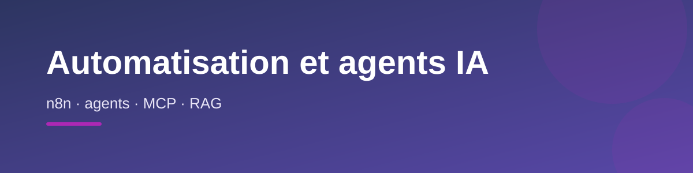
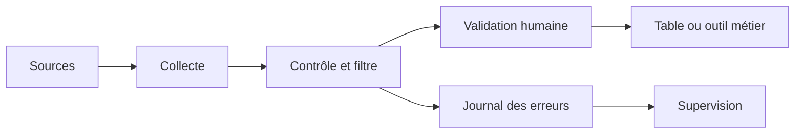
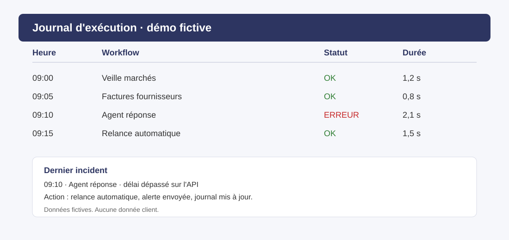

# Automatisation et agents IA

Des processus qui tournent, des agents qui citent leurs sources, une supervision qui prévient avant l'incident.

*Automation and AI agents: n8n workflows, MCP servers, RAG with source citations and supervision.*

## Ce que je peux faire pour vous

- **Conseil** : audit des processus, cadrage, choix des outils, gouvernance des agents.
- **Automatisation** : n8n, agents, MCP, RAG, intégrations d'API, validation humaine.
- **Formation** : parcours n8n et agents, de l'acculturation à la mise en production.

## Cas 1 · factures fournisseurs d'une concession automobile

### Contexte

Une concession automobile reçoit des factures fournisseurs dans des formats variés. Le traitement manuel prend du temps et crée des erreurs de saisie.

### Intervention

Conseil puis automatisation. 2026.

### Démarche

1. Cartographier le flux : réception, lecture, contrôle, saisie, archivage.
2. Construire un pipeline de lecture et de contrôle, avec validation humaine sur les cas incertains.
3. Mettre en place un journal des erreurs et une supervision.

### Résultat

- Un flux de traitement plus rapide et plus traçable.
- Une validation humaine sur les cas ambigus.
- Un journal des incidents.

### Point dur surmonté

Les formats de factures changent d'un fournisseur à l'autre. Le pipeline a été conçu pour signaler les cas non reconnus plutôt que de deviner.

## Cas 2 · n8n pour un éditeur de logiciels de gestion

### Contexte

Un éditeur de logiciels de gestion forme son équipe marketing ops. Le groupe est en partie anglophone.

### Intervention

Formation n8n, 2 jours, en 2026.

### Démarche

1. Partir des tâches répétitives de l'équipe.
2. Construire des workflows simples, puis un agent avec outils.
3. Terminer par la supervision et les erreurs.

### Résultat

- Une équipe autonome sur les workflows de base.
- Des démos qui parlent aux deux langues du groupe.
- Un cadre commun pour les prochains workflows.

### Point dur surmonté

Le groupe était en partie anglophone. Les supports et les démos ont été adaptés pour que tout le monde suive le même fil.

## Cas 3 · n8n pour une agence web de PME

### Contexte

Une agence web de PME veut suivre les marchés publics et automatiser une partie de sa veille.

### Intervention

Formation n8n, 2 jours, à distance, en 2026.

### Démarche

1. Construire une collecte d'annonces publiques.
2. Ajouter un filtre, un dédoublonnage et un journal.
3. Construire un agent de veille avec deux outils.

### Résultat

- Une veille datée et dédoublonnée.
- Un agent qui cite ses sources.
- Une supervision des erreurs.

### Point dur surmonté

Une API publique peut renvoyer une erreur dans un corps 200. Le workflow apprend à vérifier le contenu, pas seulement le code HTTP.

## Architecture

## Démo exécutable

Une seule démo générique : [`demo/workflow-veille-simple.json`](demo/workflow-veille-simple.json). Trois nœuds, aucune credential, une URL publique à remplacer. Elle montre le principe, pas la production complète.

## Captures de démos fictives

## Me contacter

- Site : https://next-gen-ai.fr
- LinkedIn : https://www.linkedin.com/in/adam-ai-011540356

---

*La démo est sous licence MIT, voir `LICENSE`. Le reste du contenu est sous tous droits réservés.*
